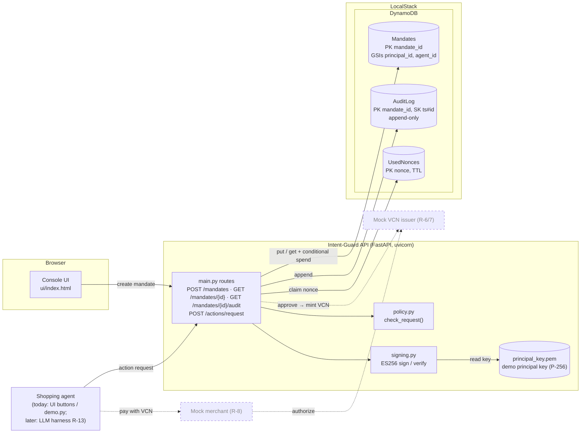
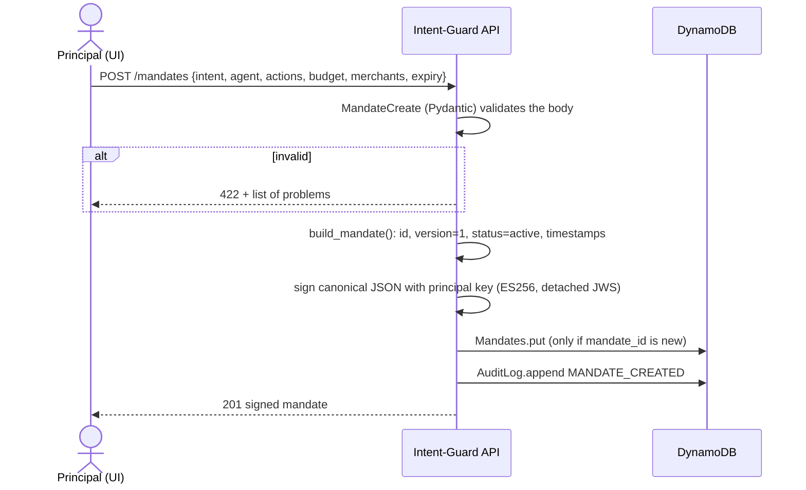
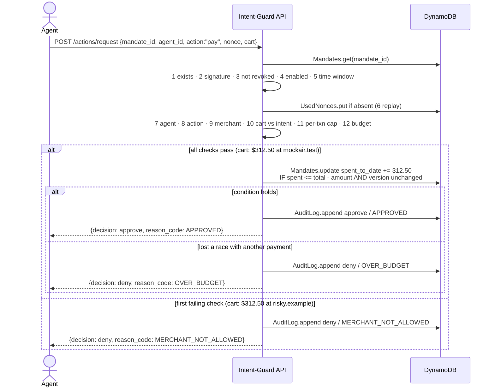

# Architecture (PDR Section 6)

Scope: the Objective 1 slice, which is one Intent Mandate created by a human and checked on every agent action. Later pieces (mock VCN issuer, mock merchant, LLM agent) are dashed in the component view so the slice fits into the full system.

## 1. Component view: what the pieces are and how they connect

Code layout:

| Module | Role |
|---|---|
| `app/models.py` | Pydantic models that validate every request, plus `build_mandate()` which creates the mandate record |
| `app/signing.py` | Canonical JSON and ES256 detached JWS sign/verify (pure) |
| `app/policy.py` | The ordered checks that return approve/deny plus a reason code (pure; side effects passed in) |
| `app/db.py` | All DynamoDB calls (boto3) |
| `app/main.py` | FastAPI routes that wire HTTP to the modules above |

Deployment later: the same FastAPI app can run on Lambda behind API Gateway by wrapping it with Mangum. No Lambda-specific code is needed.

Trust note: in a real deployment the **principal** signs on their own device, and the API would only verify. For the demo the API signs with `principal_key.pem`, which stands in for the principal's device key. The app generates it on first start, it is readable only by the local user, and it is gitignored.

## 2. Runtime view: what happens step by step

### 2a. Create mandate

### 2b. Action request: one approve, one deny

Every request is written to `AuditLog`, including denials and requests against unknown mandates. Malformed requests (missing fields, a non-integer amount) get a 422 and are not logged, because they never reach a policy decision.

## 3. Reason codes implemented

`MANDATE_NOT_FOUND`, `INVALID_SIGNATURE`, `MANDATE_REVOKED`, `MANDATE_DISABLED`, `MANDATE_NOT_YET_VALID`, `MANDATE_EXPIRED`, `NONCE_REPLAYED`, `AGENT_MISMATCH`, `ACTION_NOT_ALLOWED`, `MERCHANT_NOT_ALLOWED`, `INTENT_CART_MISMATCH` (currency for now), `OVER_PER_TXN_LIMIT`, `OVER_BUDGET`.

Not implemented yet, because their fields are outside the Objective 1 schema: `MERCHANT_BLOCKED`, `MCC_NOT_ALLOWED`, `ITEM_NOT_ALLOWED`.
